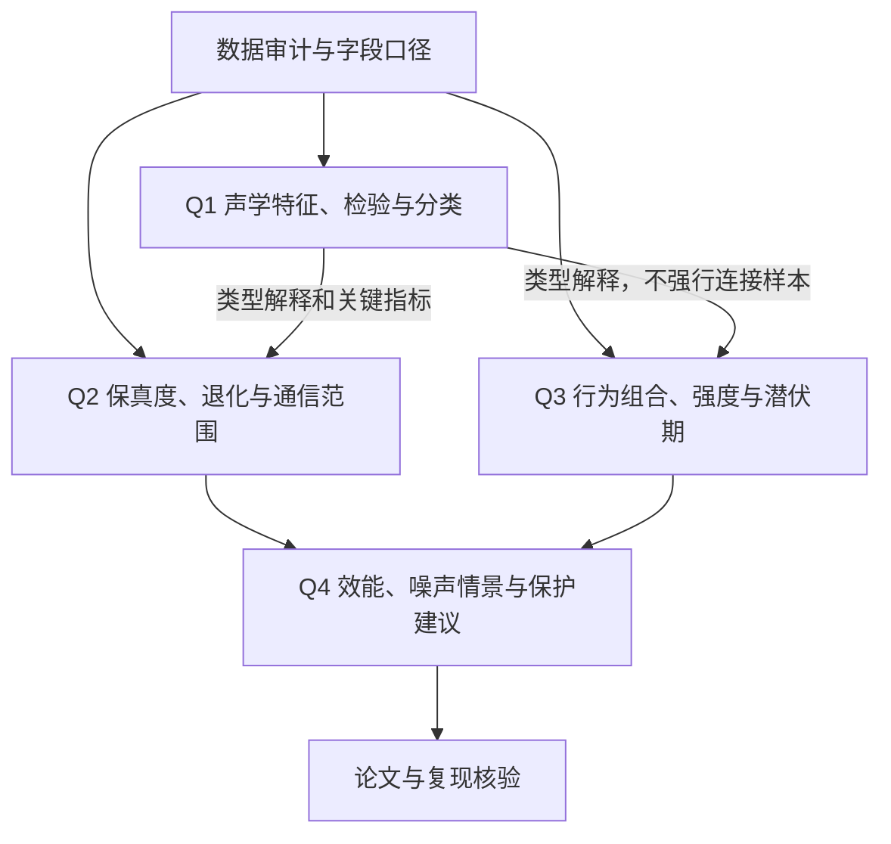

# 项目总体研究框架

本文仅保留研究框架。团队任务及截止时间统一见 [TEAM_PLAN.md](TEAM_PLAN.md)。

## 研究目标

以非洲企鹅的声学特征、传播相关系数和回放行为解释三类叫声差异，估计通信范围与响应，评估噪声情景。最终交付英文论文、可复现代码、必要支撑材料及 AI 使用说明。

数据集没有已确认的逐条连接键，跨问先按类型、距离和情境整合。阈值是识别情景假设，不是实测听觉界限；无响应不等于未感知。

## 四问依赖

共享口径确定后 Q2/Q3 可并行推进，Q1 的解释随后用于整合。

| 模块 | 输入与任务 | 交付及验收 |
|---|---|---|
| 审计 | Data01–11、题面与补充材料 | 字典、异常清单、处理规则；原始值和哈希不变 |
| Q1 | Data01：分布、至少两种非参数检验、分类与关键因素 | 描述表、校正检验、效应量、折外指标与混淆矩阵；预处理无泄漏 |
| Q2 | Data03–11：联合声谱图/幅度谱/包络相关 | 分量和综合保真度、分层阈值、潜在/可靠识别范围及区间、权重/阈值敏感性 |
| Q3 | Data02：自然叫声与对照、情境/类型/距离/群体规模 | 共同框架的组合概率、强度和潜伏期、代表条件预测及区间 |
| Q4 | Q2/Q3 输出与情境 | 显式效能函数和权重解释、半径或响应人数、噪声情景与建议的适用条件 |

Q3 代表条件：Npenguins=8、Distance=50/100/150 m，分别预测 control/flat/mod/tv 与三类 Context；平均情境时注明权重。响应概率、响应者条件潜伏期与强度分别报告，无响应单独保留。发声次数和行为持续时间不是启动潜伏期。

## 每个小问的研究闭环

Q1–Q4 按以下过程开展。各步骤允许反复迭代：验证或敏感性分析发现问题时，返回数据处理或模型构建阶段。已有审计、代码和上游结果直接复用，不必每问重复完成。

1. **理解题目（Problem Understanding）**

   明确要解决的问题、输入和最终需要回答的内容。

   产物：问题拆解、目标变量、输出清单。

2. **数据审计与预处理（Data Audit）**

   检查格式、单位、缺失、异常、重复和样本独立性，保留原值并说明处理依据。

   产物：数据字典、异常记录、清洗数据。

3. **探索性数据分析（EDA）**

   通过统计量、分布图、相关性等理解数据、寻找规律，区分探索发现与验证结论。

   产物：描述统计表、探索性图表、初步发现。

4. **数学建模（Model Formulation）**

   将实际问题转化为数学问题，确定变量、参数、假设、公式和模型，沿用已有候选方案并记录选择依据。

   产物：模型定义、数学推导、假设说明。

5. **模型实现（Implementation）**

   使用 Python、MATLAB 等实现模型，先建立可解释基线，再按证据改进；遵循既有数据接口。

   产物：可运行代码、模型参数、实验记录。

6. **模型验证（Validation）**

   检查数学与生态合理性、拟合或预测可靠性，按数据层级选择验证方式，避免训练验证泄漏。

   产物：评价指标、残差分析、验证结果。

7. **敏感性与稳健性分析（Sensitivity Analysis）**

   改变参数、假设、阈值和数据处理方式，检查结论是否稳定，说明不确定性与外推边界。

   产物：对比实验、敏感性图表、适用范围。

8. **回答问题与论文写作（Interpretation & Writing）**

   将数学结果转化为实际意义，逐项回答题目，说明局限并核实引用。

   产物：正式章节、图表、结论和引用。

这是研究方法说明，不新增任务、角色或排期；成员及截止时间仍只在 TEAM_PLAN.md 维护。具体实验过程放在 experiments/，各步骤产物按下节现有目录保存，模型选择与取舍记入 MODELING_DECISIONS.md。

## 产物与复现

`data/raw/` → `data/processed/` → `src/` → `results/q1/` 至 `results/q4/` → `figures/` → `paper/latex/`。这是计划路径，尚不表示文件已生成。

每次有效实验在 `experiments/` 记录实验 ID、负责人、时间、代码提交、输入哈希、清洗版本、参数、种子、依赖版本、验证方式、输出和限制。不可复现的数字不进入最终论文。派生数据和 results 默认不入 Git；需审阅的精简汇总及元数据放 `experiments/reports/`，不复制逐条原始数据。文献笔记放 `literature/` 并记录来源。

## 质量门槛

先可解释基线，再据验证收益增加复杂度。分类在训练折内预处理；回放按 expID 验证；传播重采样单位须核实。图表注明有效 n、单位、条件和区间类型。阈值、权重、异常、无响应和外推写入决策日志。

核心模型、求解与解释由队伍独立判断；AI 辅助内容经人工核验后如实记录。

相关文档：[团队任务](TEAM_PLAN.md)、[数据接口](TEAM_ROLES.md)、[模型决策](MODELING_DECISIONS.md)、[数据字典](../data/README.md)、[GitHub 流程](../GITHUB_WORKFLOW.md)。
