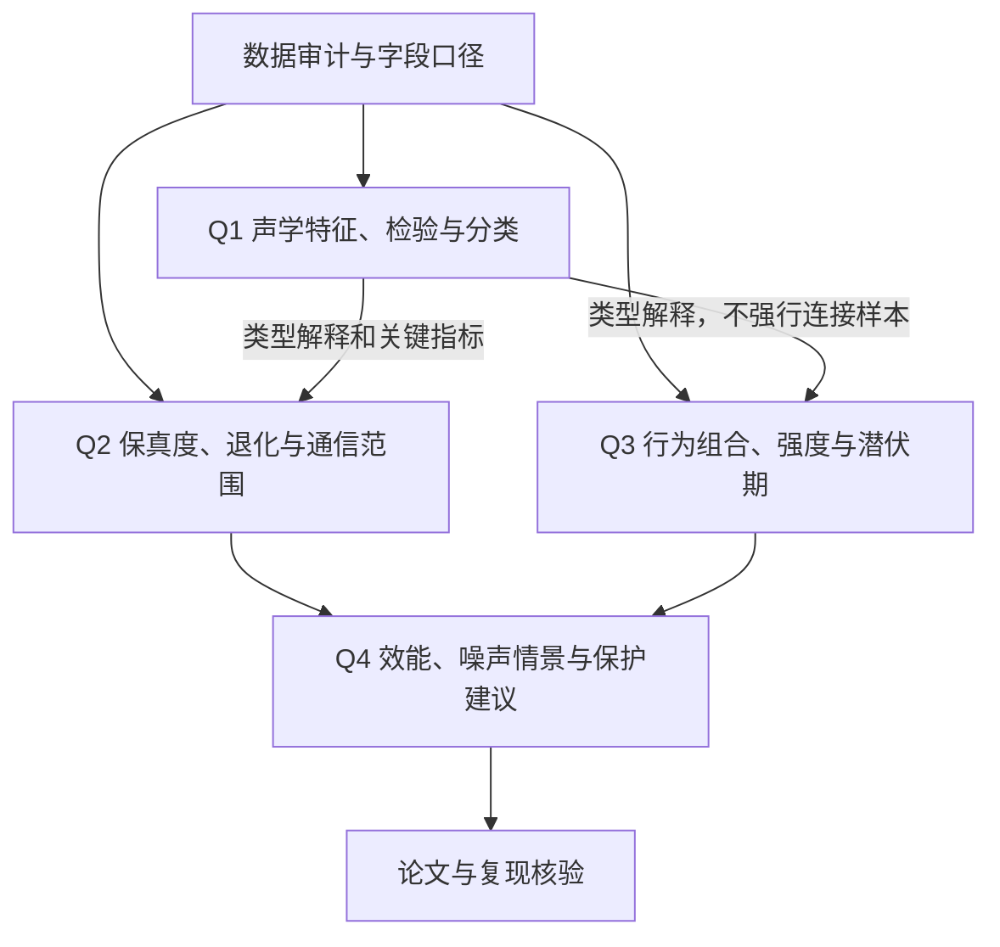

# 项目总体研究框架

状态：2026-11-26 执行基线草案，待 P1/P2/P3 审阅；模型尚未拟合。

## 研究目标

以非洲企鹅的声学特征、传播相关系数和回放行为解释三类叫声差异，估计通信范围与响应，评估噪声情景。最终交付英文论文、可复现代码、必要支撑材料及 AI 使用说明。

数据集没有已确认的逐条连接键，跨问先按类型、距离和情境整合。阈值是识别情景假设，不是实测听觉界限；无响应不等于未感知。

## 四问依赖

共享口径确定后 Q2/Q3 可并行推进，Q1 的解释随后用于整合。

| 模块 | 输入与任务 | 交付及验收 |
|---|---|---|
| 审计 | Data01–11、题面与补充材料 | 字典、异常清单、处理规则；原始值和哈希不变 |
| Q1 | Data01：分布、至少两种非参数检验、分类与关键因素 | 描述表、校正检验、效应量、折外指标与混淆矩阵；预处理无泄漏 |
| Q2 | Data03–11：联合声谱图/幅度谱/包络相关 | 分量和综合保真度、分层阈值、潜在/可靠识别范围及区间、权重/阈值敏感性 |
| Q3 | Data02：自然叫声与对照、情境/类型/距离/群体规模 | 共同框架的组合概率、强度和潜伏期、代表条件预测及区间 |
| Q4 | Q2/Q3 输出与情境 | 显式效能函数和权重解释、半径或响应人数、噪声情景与建议的适用条件 |

Q3 代表条件：Npenguins=8、Distance=50/100/150 m，分别预测 control/flat/mod/tv 与三类 Context；平均情境时注明权重。响应概率、响应者条件潜伏期与强度分别报告，无响应单独保留。发声次数和行为持续时间不是启动潜伏期。

## 产物与复现

`data/raw/` → `data/processed/` → `src/` → `results/q1/` 至 `results/q4/` → `figures/` → `paper/latex/`。这是计划路径，尚不表示文件已生成。

每次有效实验在 `experiments/` 记录实验 ID、负责人、时间、代码提交、输入哈希、清洗版本、参数、种子、依赖版本、验证方式、输出和限制。不可复现的数字不进入最终论文。派生数据和 results 默认不入 Git；需审阅的精简汇总及元数据放 `experiments/reports/`，不复制逐条原始数据。文献笔记放 `literature/` 并记录来源。

## 里程碑（北京时间）

以下是内部目标，不代表已完成。材料包注明正式截止为 2026-11-30 09:00，最终以组委会通知为准。

| 节点 | 内部目标时间 | 门槛 | 主责 |
|---|---|---|---|
| M0 | 11-27 10:00 | 字段、缺失、冲突、独立性和窗口口径明确；未知项登记 | P1，全员确认 |
| M1 | 11-27 22:00 | Q1–Q3 各有可复现基线及局限记录 | P1/P2/P3 |
| M2 | 11-28 20:00 | 模型比较、验证和代表条件表，接口冻结 | 全员 |
| M3 | 11-29 12:00 | Q4 情景与英文完整初稿，图表可追溯 | P2 整合，P3 统稿 |
| M4 | 11-29 22:00 | 复现、匿名、引用、图表和 AI 记录核查 | 全员 |
| M5 | 11-30 08:00 | 内部提交目标，材料齐备并预留上传时间 | P3 协调；实际提交人待指定 |

## 质量门槛

先可解释基线，再据验证收益增加复杂度。分类在训练折内预处理；回放按 expID 验证；传播重采样单位须核实。图表注明有效 n、单位、条件和区间类型。阈值、权重、异常、无响应和外推写入决策日志。

核心模型、求解与解释由队伍独立判断；AI 辅助内容经人工核验后如实记录。

相关文档：[分工与接口](TEAM_ROLES.md)、[模型决策](MODELING_DECISIONS.md)、[数据字典](../data/README.md)、[GitHub 流程](../GITHUB_WORKFLOW.md)。
